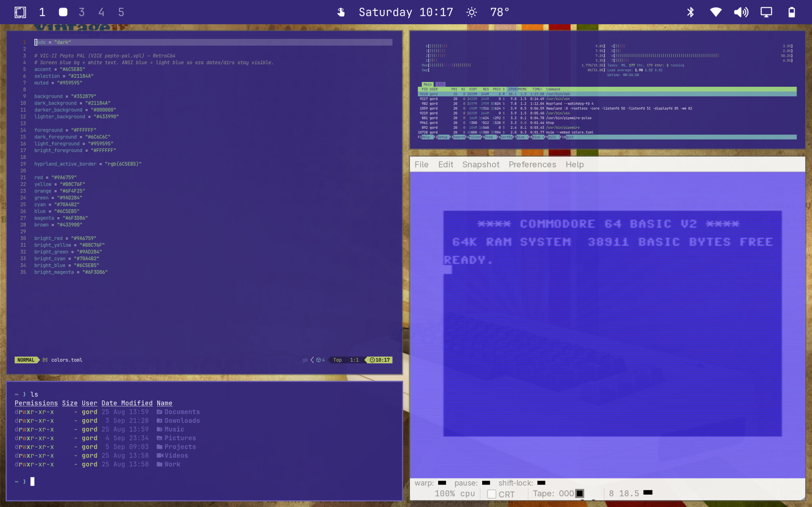

# RetroC64 — Omarchy Theme

Commodore 64 VIC-II blue theme for [Omarchy](https://omarchy.org).
Palette from VICE Pepto PAL (`pepto-pal.vpl`).



## Install

```bash
mkdir -p ~/.config/omarchy/themes/retro-c64
rsync -a --delete \
  --exclude scratch --exclude .superpowers --exclude .git \
  ./ ~/.config/omarchy/themes/retro-c64/
omarchy theme set retro-c64
```

## Backgrounds

Cycle with `omarchy theme bg next`.

| File | Author / uploader | Source | License / notes |
|---|---|---|---|
| wallhaven-d5zo2o.png | [ka1tek](https://wallhaven.cc/user/ka1tek) (Wallhaven) | [wallhaven.cc/w/d5zo2o](https://wallhaven.cc/w/d5zo2o) | User-submitted; original owner unknown |
| wallhaven-rr69zm.png | [payursky](https://wallhaven.cc/user/payursky) (Wallhaven) | [wallhaven.cc/w/rr69zm](https://wallhaven.cc/w/rr69zm) | User-submitted; original owner unknown |
| wallhaven-8o711k.png | [balazssomfalvi](https://wallhaven.cc/user/balazssomfalvi) (Wallhaven) | [wallhaven.cc/w/8o711k](https://wallhaven.cc/w/8o711k) | User-submitted; original owner unknown |
| wallhaven-13xxrv.jpg | [Lorenzo Herrera](https://unsplash.com/@lorenzoherrera) | [unsplash.com/photos/p0j-mE6mGo4](https://unsplash.com/photos/p0j-mE6mGo4) | [Unsplash License](https://unsplash.com/license) (Commodore PET Mini) |
| wallhaven-4xew8l.jpg | [Nosing](https://wallhaven.cc/user/Nosing) (Wallhaven) | [wallhaven.cc/w/4xew8l](https://wallhaven.cc/w/4xew8l) | User-submitted; original owner unknown |
| commodore-vintage.jpg | [brookemeyer](https://wallpapersafari.com/w/w7hxB9) (WallpaperSafari) | [wallpapersafari.com/w/w7hxB9](https://wallpapersafari.com/w/w7hxB9) | User-submitted; local copy is 1920×1200 (listed at 1024×768) |
| commodore-hd.jpg | [tterrell](https://wallpapersafari.com/w/teQEqI) (WallpaperSafari) | [wallpapersafari.com/w/teQEqI](https://wallpapersafari.com/w/teQEqI) | User-submitted; original owner unknown |

## Notes

- Does not change your monospace font (keep JetBrainsMono or whatever you use).
- Terminal colors are generated by Omarchy from `colors.toml` when the theme is applied.
